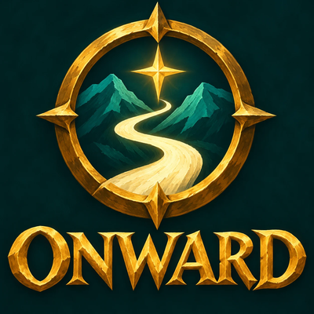
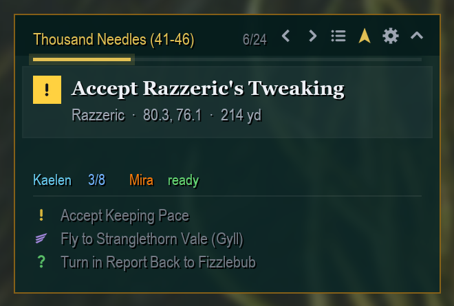

# Onward

A free leveling and profession guide for **World of Warcraft: Forever** (formerly *Sloppy Questing*): every zone for both factions, 1-300 in every profession, a nav arrow, flight advice and quest-mob targeting. It's in beta: routes are generated from quest data and not all of them have been played through yet.

## Install

1. **[Download Onward.zip](https://github.com/jghost7/Onward/releases/latest/download/Onward.zip)** (always the newest version). Older versions and what changed in each are on the [Releases page](https://github.com/jghost7/Onward/releases).
2. Unzip it into `World of Warcraft\_forever_\Interface\AddOns`, so you end up with `AddOns\Onward\Onward.toc`.
3. Upgrading from Sloppy Questing? Delete the old `AddOns\SloppyQuesting` folder, or both copies will load.
4. Start the game (or `/reload`) and type `/ow` to show the panel, or `/ow guides` to pick a guide.

Don't use the green **Code > Download ZIP** button: that's the source with the build tools, not the addon.

Optional: [Questie](https://github.com/Questie/Questie) for more accurate quest locations, party progress and expected drop rates; TomTom for extra waypoints.

Found a problem? [Open an issue](https://github.com/jghost7/Onward/issues) with the guide name, the step you were on, and what happened.

---

*The rest of this page is for working on the addon.* The code is written from scratch and nothing is taken from Zygor or RestedXP.

## Layout

| Path | What it is |
|---|---|
| `Onward/` | The addon. A junction links it into `X:\World of Warcraft\_forever_\Interface\AddOns\Onward`, so edits here are live after `/reload` |
| `Onward/Guides/` | Guide files plus `FORMAT.md`, the guide syntax |
| `tools/draft_all.py` | Regenerates every zone draft into `Onward/Guides/Draft/` and rewrites `Guides.xml`. Covers both factions and all open-world zones: classic plus Riverglades, Zephras Isle, Mount Hyjal and Shen'dralas. Skips dungeons, battlegrounds, Darkspear Islands (PvP) and capital cities. Zones that span more than 10 levels are split into bands linked with `next`. Prints a quality table: steps without a pin, and quests left out of the route |
| `tools/quest_value.py`, `tools/value_report.py` | Quest value. XP comes from Questie's classic table plus its Forever traces; time is the quest's extra route travel plus objective work, with counts read from the quest text and mob XP included. The value tags each quest `mid` (dropped in Fastest) or `low` (dropped in Efficient and Fastest). Chains are valued as a whole; quests under 2 min are always kept; Efficient keeps at least 85% of a zone's XP and Fastest at least 60%. In game, `/ow mode` or Options picks the mode |
| `tools/preview_ui.py` | Mock-up of the glass UI over a game screenshot, built with the addon's textures and layout. It's a design preview, not a capture |
| `tools/route_report.py`, `tools/route_stops.py` | Route quality. The report compares the greedy route with the optimized one: total travel, trips back, and a lower bound on the trips back that quest chains force. The stops script prints a route as places visited, with each revisit marked |
| `tools/draft_guide.py` | Drafts a zone guide. The route starts greedy, then an optimizer reorders it: first by moving runs of steps elsewhere when that shortens the route, then four simulated-annealing runs. Every reorder keeps the hard rules: accept before objectives before turn-in, prerequisites first, at most 20 quests held, and each quest's real minimum level against a simulated player level from Questie's Forever database, e.g. `python tools/draft_guide.py --zone Riverglades --map 2548 --faction Alliance`. `tools/questiedb.py` decodes QuestieDB's base64-CBOR TOC store. The output is GPL-3.0 because it comes from Questie's data |
| `tools/draft_professions.py` | Profession guides (`Onward/Guides/Professions/`, one per profession and faction, plus `ProfData.lua` with trainers, vendors and item names). Recipes, skill-up thresholds (TrivialSkillLineRankLow = yellow, High = grey; chance falls linearly between), reagents, created items and recipe items come from Forever's own client tables, exported by wago.tools (`wowf` build, cached in `tools/data/db2/<build>/`; `--fetch` refreshes). Left out: Season of Discovery rows (spell ids 400000-499999, present in Forever's tables but not in the game), cooldown recipes, reputation and drop-only recipes, and Forever-only recipes (ids from 1,000,000) unless a vendor sells them, since no client table says which trainer teaches what. At each skill point it picks the cheapest recipe per expected skill-up (vendor price, else an estimate from sell price and item level; crafted reagents costed from their own mats), with a penalty for switching. Trainers, vendors and herb/ore spawns come from Questie. Herb and ore requirements are the game's fixed node skills |
| `tests/` | Headless test: a WoW API mock run under Lua 5.1. Run `python tests/run.py` (needs `pip install lupa`) |

## Releasing

1. Write what changed under a new `## <version>` heading in `Onward/CHANGELOG.md`.
2. `python tools/package.py --bump patch` (or `minor` / `major`). It runs the tests and stops on a failure, writes the version into `Onward.toc` (the only place it lives; the game reads it from there), and writes `dist/Onward-<version>.zip` with one top-level `Onward/` folder. It then reopens the zip and checks that every file the TOC and `Guides.xml` load is inside. It never overwrites a zip that already exists for that version.
3. Commit and push, then tag the version: `git tag v<version>` and `git push origin v<version>`. GitHub Actions (`.github/workflows/release.yml`) rebuilds the zip, runs the tests and publishes the release with the changelog entry, as `Onward-<version>.zip` and as `Onward.zip` (the README's download link always points at the newest one). The tag must match the TOC version or the build stops.
4. Upload the zip on CurseForge: release type Beta for test builds, the WoW Forever game version, and the changelog entry. Questie and TomTom go under Relations as optional dependencies.

License: GPL-3.0 (`Onward/LICENSE.txt`), required because the guides are generated from Questie's GPL data; `Onward/CREDITS.txt` says so in the shipped addon.

## Modules

| File | Job |
|---|---|
| `Core.lua` | Event bus, saved variables, debounced refresh, `/ow` commands |
| `QuestState.lua` | One cached quest-log snapshot, rebuilt only when the log changes. Fires `WF_QUEST_STATE` |
| `Guide.lua` | Guide registry, step parser (runs only when a guide is picked), step engine, and the "Quest log (auto)" guide. A `turnin` whose quest is in the log but unfinished is "waiting": never the current step, announced once, listed by `G:Waiting()` on the panel, and offered again ("Ready to turn in", `G:GoToStep`) once the quest is finished |
| `Prof.lua` | Profession guides' runtime: ranks (`GetProfessions` / `GetProfessionInfo`), recipes you know with their live colour (read from `C_TradeSkillUI` whenever the profession window opens, kept per character), mats left against bags and bank, the nearest trainer / book vendor / recipe vendor / Artisan quest giver for the arrow, and "instead now": the best orange or yellow recipe you know when the route's recipe is green, unknown or unmakeable. `train`, `craft` and `gather` steps complete on your skill, not on clicks |
| `Waypoint.lua` | Blizzard map pin and arrow (TomTom optional). Uses quest super-tracking when a step has no coordinates |
| `QuestieBridge.lua` | Optional, read-only: quest-giver and turn-in locations, party progress from Questie |
| `Auto.lua` | Accepts the guide's quests and turns in finished quests. Hold Shift to pause. Never chooses between rewards |
| `Party.lua` | `ONWRD` addon messages for step and quest state, merged with Questie's party data. Queues during chat lockdown |
| `Recorder.lua` | `/ow rec start/stop/mark/show` writes a guide as you play |
| `UI.lua` | Panel: icon buttons, step icons, party chips, toasts, guide picker, copy window |
| `Skin.lua` | The theme every window draws through (`S.Glass`, `S.Nine`, `S.Hover`, `S.Badge`, `S.Accent`, `S.Font`; `S.Refresh()` repaints live). **Flat** (default): Ellesmere-style solid dark panel, 1px black border, darker title strip, square fills, buttons, checkboxes and badges, one clean font, accent #0CD29D. When EllesmereUI is installed, its public skinning API (`EllesmereUI.RegisterSkin`) supplies the user's accent, panel colour and font, and `OnLooksChanged` repaints; nothing of EllesmereUI's art or code is copied (its licence reserves all rights). **Glass**: drop shadow, tinted rounded body, grain, sheen, lit rim (WoW can't blur behind a frame). Options > Panel > Look switches; opacity is the panel opacity setting (default 0.85) |
| `Target.lua` | Quest-mob targeting: a crosshair on the step card for kill and loot steps, and a key binding (Key Bindings > AddOns > Onward). It covers every quest in `Guide:Group()`: the current kill/loot step plus up to three later ones already in the log whose objective area is within 350 yd (no travel step between; the card lists them as "Also here"). It is a secure button running a `/targetexact` macro built from those steps' `mobs` plus any "X slain" objective, each quest's first choice before any second choice, cut at the 255-character macro limit (about five names); finished kills drop out, corpses are skipped, and the target gets a skull (option, via the secure `/tm` command: on Forever any `/run` in a macro is force-tainted, and calling `SetRaidTarget` from it raised "ForceTaint_Strong has been blocked"). Blizzard locks secure buttons in combat, so a change made in combat applies when combat ends. The button is placed by screen position, not anchored to the panel, so the panel can still redraw in combat |
| `Drops.lua` | Drop rates per kill for "collect" objectives. Forever blocks the combat log, so kills are deaths seen on the target and enemy nameplate tokens (`UnitIsDead` after you fought the mob: threat, or your target in combat; not tap-denied), matched by mob **name** because GUIDs can be secret; target and plate reports of one death count once. A kill counts toward an item when Questie lists that mob name in the item's `npcDrops`, or the mob has dropped it for you (kills held from before that first drop are added then). Drops come from loot windows (`GetLootSourceInfo`, one per corpse; pickpocketing a living target and re-opened corpses skipped). Looted corpses are kept as a fallback denominator, used when no kills were seen or drops exceed kills (kill watching missed some). The expected rate is Questie's `GetItemDroprate` (Wowhead, private-server data for quest-only drops, or Questie corrections), averaged over npc ids sharing the name; before the first counted kill the line still shows (expected rate and kill estimate, or "counting your kills") so players can see the feature is on; an objective counts as an item when the client says so or Questie lists that item name for the quest; "luckier / unluckier" needs 5 rated kills and a binomial z beyond ±1. Account-wide in `OnwardDB.drops` (schema 2); `/ow drops` lists, `/ow drops reset` clears, `/ow drops debug` shows what kill watching can see in game (names, GUIDs, threat, plates) and the last events. Not yet verified in game |
| `Bindings.xml` | The "Target quest mob" key binding |
| `Arrow.lua` | Nav arrow: rotates toward the target (world coordinates, `GetPlayerFacing`) and colours green, amber or red by facing. Shows distance, arrival time and an arrival ring. On kill / loot / use steps it points at the nearest spawn of an unfinished objective (`QuestieBridge:ObjectiveSpots`), re-checked each second and switched only when another spot is 30% closer; without Questie it uses the step's area centre. When the game hides the player's facing it keeps the last direction, greyed. `/ow arrow debug` prints position, target, advice and angles. Its OnUpdate runs only while it is shown, capped at about 30 fps |
| `Route.lua` | Travel route on the world map (Options > Navigation: Off / Current / Next 3). Dotted line from the player to the arrow's target (via both flight masters when advice says fly, flight leg in the travel colour), then on through the next steps' locations with numbered stops. Built in world coordinates and projected with `C_Map.GetMapPosFromWorldPos` onto whichever map is shown; dot size and spacing are divided by the canvas scale so they stay constant on screen. Draws only while the world map is open (0.5 s timer) |
| `Travel.lua` | World positions and flight paths learned (`C_TaxiMap.GetTaxiNodesForMap` on both continents). Suggests a flight when it beats running by 25%, and keeps that suggestion (same flight masters) while it still saves 10%, so the arrow doesn't flip between the flight master and the quest. `PlayerWorld` walks up parent maps when the best map (a cave or building) has no world position. At the flight master it picks the flight (`TakeTaxiNode`); Shift skips that |
| `Options.lua` | Options window (`/ow options`, the gear, or right-click the arrow), plus an entry under Blizzard Settings > AddOns |
| `media/` | Textures drawn by `tools/make_media.py` (white TGA, tinted in game) |

## Performance rules

- No `OnUpdate` handlers.
- Two timers exist:
  - a 0.5 s proximity check, only while a `goto` step is current;
  - a 1 s distance label, only while a pinned step is shown.
- Quest events are combined into one refresh per burst.
- Guides are parsed when you pick them, not at login.
- The step search moves forward from the current step. It rescans from the start only when a quest is abandoned.

## Forever API notes

- Forever uses the modern API (`C_QuestLog`, `C_GossipInfo`, `C_ChatInfo`). I checked the calls against the addons installed on the Forever client.
- Some values can be secret on Midnight-era clients. `W.Safe()` drops them, for example `UnitName("npc")`.
- Addon messages are blocked during `C_ChatInfo.InChatMessagingLockdown()`. Party messages wait in a queue until it ends.
- `C_SuperTrack.SetSuperTrackedUserWaypoint` is reported as protected on some builds, so it is wrapped in `pcall`.
