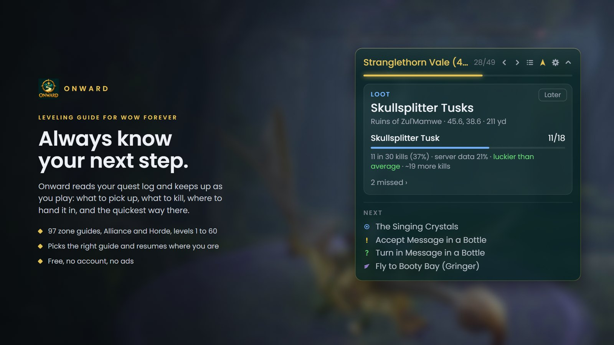
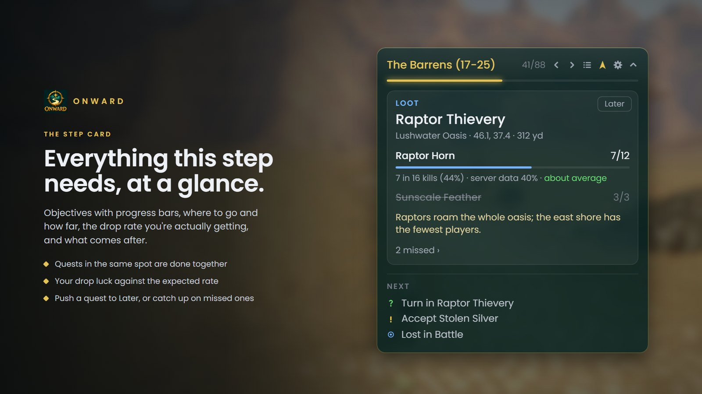
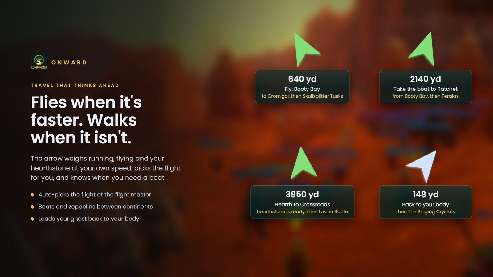
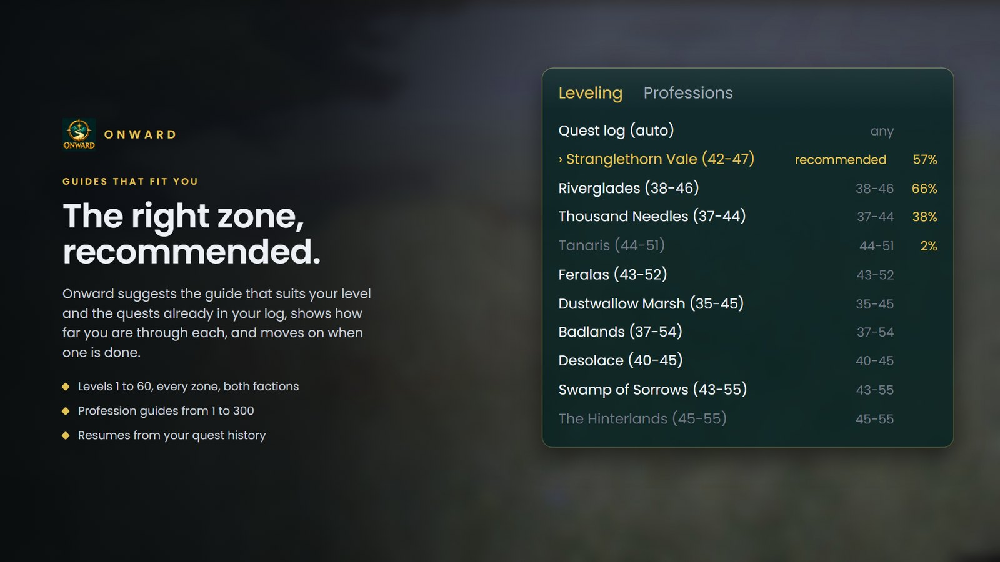
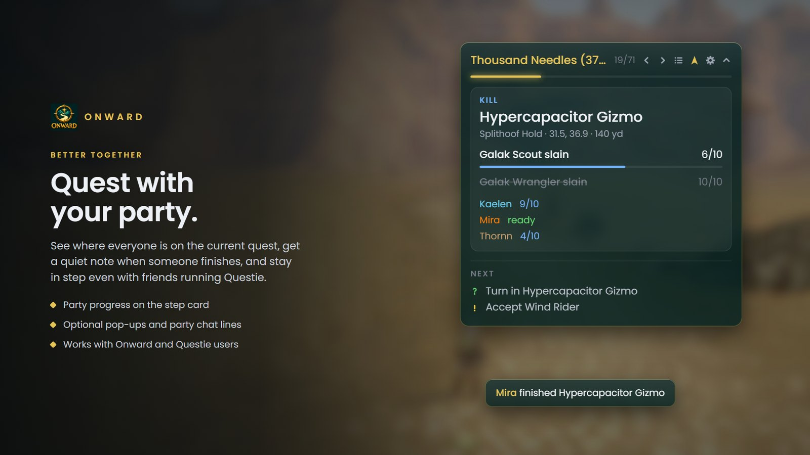
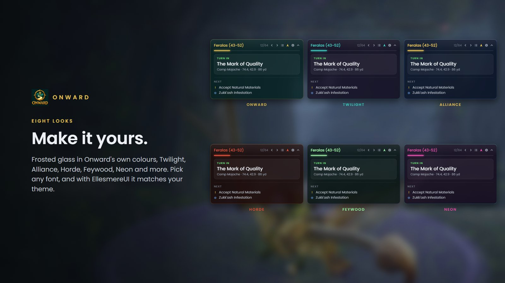

<!--
CurseForge project text for Onward. Two parts:
  SUMMARY     -> the project's "Summary" field (one line, shown in search results)
  DESCRIPTION -> the "Description" field (set the editor to Markdown, paste everything below the line)
Images load from GitHub (gallery/web/ on main), so push gallery/web before pasting.
-->

SUMMARY:
Free leveling and profession guide for WoW Forever: pick any zone, follow the arrow, skip the quests that aren't worth it. 1-60 both factions, 1-300 every profession.

---

# Onward

**A free leveling guide for World of Warcraft: Forever.** Onward tells you what to do next, points you there, and keeps up as you play: pick up these quests, kill these mobs, hand them in, take this flight.

### Why Onward

- **You choose the zone.** 97 zone guides, Alliance and Horde, 1 to 60. Play the zone you like; Onward recommends one from your level and quest log, and picks up mid-zone from what you've already done.
- **Skip what isn't worth it.** Three quest modes, from every quest to the best XP per hour.
- **Built for the fight over tags.** A target button that finds the nearest untagged quest mob, a "come back later" when an area is crowded, and your real drop luck on every collect quest.
- **Plays nice with your group.** See everyone's progress on the current quest, Onward and Questie users alike.
- **Light and private.** No companion app, no account, and nothing leaves the game. Free and open source.

> **Beta.** The routes are generated from quest data and not all of them have been played through yet. Expect the odd step in a strange order, and please report it (see *Reporting problems*).

## Every step, at a glance

A compact panel built around the current step: what kind of step it is, where and how far, its objectives with progress bars, the quests you can do in the same spot, and what comes next.

- **Quests done together:** quests in the same place are bundled, not one hand-in at a time.
- **Drop rates, lucky or not:** each collect objective shows your drop rate per kill against the expected one, e.g. *3 in 14 kills (21%) · Wowhead 35% · unluckier · ~9 more kills*. Expected rates come from **Questie** when it's installed; your own rate works without it. `/ow drops` lists them across your characters.
- **Quest hints:** tricky quests get a short hint (where in the sunken ship the charts are, which path leads up). Write your own with `/ow hint <text>` and share them with `/ow hints`. Hover the step to read the quest text.
- **Too crowded? Come back later.** When most of the quest's mobs around you are tagged by others, Onward offers to move on, reminds you when you're back in the area, and returns to it at the end of the guide (or `/ow later`, or shift-right-click the step).

### Quest-mob targeting and quest items

On kill and loot steps a crosshair appears next to the step. Click it, or **bind a key** (Key Bindings > AddOns > Onward), to target the nearest living quest mob and put a skull on it. With enemy nameplates on, it skips mobs someone else has tagged. When the quest has you use an item (fletch the bundles, throw the spear), a **quest item button** appears with its icon, count and cooldown. Prefer them on your bars? Options > Navigation > Buttons in a dock puts them in a movable dock of action-sized buttons.

## Getting around

- **Nav arrow** with distance and arrival time. It turns green when you face your target, and on kill and loot steps points at the nearest mobs, not the middle of the area.
- **Flight advice by travel time:** Onward weighs running against flying at your own speed (on foot or mounted) and suggests a flight when it saves real time. At the flight master it marks the destination on the flight map and takes the flight for you; hold Shift to choose yourself.
- **Flight points you don't have yet:** it flies you to the nearest one you know and walks you the rest of the way, and tells you when a flight point you know isn't linked to the network yet.
- **Boats and zeppelins:** a step on the other continent sends you to the right dock first, flying you there when that's faster.
- **Hearthstone advice:** each guide says which inn to bind at, and the arrow says "Hearth to <town>" when that beats running or flying.
- **The way you came:** heading back to a quest giver, the arrow follows the path you walked out on (around cliffs, over bridges) instead of a straight line.
- **Back to your body:** after you die and release, the arrow leads your ghost to your corpse, then back to the guide.
- **Route on the world map:** a dotted line through the next three stops, numbered, with flight legs marked. Map pin on the current step, and TomTom support.

## The right guide, picked for you

- A new character starts straight on its starting zone's guide, with the arrow on the first quest giver.
- Later, the recommended guide follows your quest log, the zone you're in and your level. When the guide you're on stops fitting, the panel suggests a better one (`/ow suggest`).
- Installing on a character you've already played? Onward reads your quest history: finished quests are skipped, and quests you passed by are listed so you can go back for them, or not.
- Every open-world zone from 1 to 60, including the Forever zones **Riverglades, Zephras Isle, Mount Hyjal and Shen'dralas**. Wide zones are split into level bands, and each guide hands you on to the next.

### Skip the quests that aren't worth it

Choose how thorough you want to be in Options or with `/ow mode`:

- **All:** every quest in the zone.
- **Efficient** (default): leaves out clear time sinks, like long collection grinds for little XP. Keeps at least 85% of each zone's XP.
- **Fastest:** the best XP per hour. Keeps at least 60% of each zone's XP, so you move on sooner.

A quest that unlocks a worthwhile follow-up is always kept. Elite and dungeon quests are marked ("Elite: bring a group"); playing solo, hide them and their follow-ups with `/ow group hide`.

### Less clicking

Onward accepts the guide's quests and turns in finished ones (hold Shift at an NPC to pause). It never picks a quest reward for you.

## Profession guides, 1 to 300

Every profession for both factions: Alchemy, Blacksmithing, Enchanting, Engineering, Leatherworking, Tailoring, Cooking, First Aid, Herbalism, Mining, Skinning and Fishing. Open them with `/ow prof`.

- What to craft up to which skill, about how many times, and the mats for the rest of the run against what's in your bags and bank.
- The arrow takes you to the nearest trainer when it's time to train, and to the vendor for recipes you buy. Herbalism and Mining name the best zone for each skill band.
- Open your profession window once and Onward checks the plan against your real recipe colours: when the planned recipe has gone green, or you're out of mats, it suggests the best one you can make right now.
- Built from Forever's own game data, so Forever's recipe changes are in.

## Quest with your party

- See your party's progress on the current quest: who has it, how far along they are, who's ready to turn in.
- Works with party members running Onward, and with those running **Questie**.
- Optional pop-ups and party chat lines when someone finishes a quest.

## Make it yours

Frosted-glass panels in eight looks: **Onward** (the logo's teal and gold, the default), **Glass**, **Ellesmere** (with **EllesmereUI** installed it takes your EllesmereUI accent, panel colour and font), **Twilight**, **Alliance**, **Horde**, **Feywood** and **Neon** (Options > Panel > Look). Pick any font, the game's own or any shared through SharedMedia. Small animations play once and never in combat: a sheen when a quest is ready, objectives ticking off, a glow when a guide is finished (Options > Panel > Animations). Opacity, size, upcoming steps and more are in `/ow options`, the gear on the panel, or Esc > Options > AddOns.

## Commands

| Command | What it does |
|---|---|
| `/ow` | Show or hide the panel |
| `/ow guides` | Choose a guide |
| `/ow suggest` | Switch to the recommended guide |
| `/ow prof` | Profession guides |
| `/ow options` | Options |
| `/ow mode all` / `efficient` / `fastest` | Which quests to include |
| `/ow group show` / `hide` | Elite and dungeon quests in the guides |
| `/ow later` | Come back to the current quest later |
| `/ow hint <text>` / `/ow hints` | Your own note on the current quest / list your notes to share |
| `/ow next` / `/ow prev` | Skip ahead or go back a step |
| `/ow arrow` | Show or hide the nav arrow |
| `/ow drops` | Your quest-item drop rates vs the expected ones |
| `/ow reset` | Reset frame positions |

## Optional addons

None is required.

- **Questie:** more accurate quest locations, party progress and expected drop rates.
- **TomTom:** TomTom waypoints alongside Onward's own.
- **EllesmereUI:** the panel matches your EllesmereUI colours and font.
- **SharedMedia** (or any addon that shares fonts through it): more fonts to pick from.

## Reporting problems

Leave a comment, or open an issue on [GitHub](https://github.com/jghost7/Onward/issues), with:

- the guide name and the step you were on;
- what you expected and what happened;
- for errors, the full text from **BugSack** (install BugGrabber + BugSack to capture it).

## Support the addon

Onward is free and stays free. If it saved you some time and you'd like to say thanks, you can [buy me a coffee on Ko-fi](https://ko-fi.com/onwardaddon). Nothing is locked behind it.

## License and credits

Onward is free software under the **GPL-3.0** license. Quest, NPC and item locations come from the [Questie](https://github.com/Questie/Questie) database (GPL-3.0). The routes are generated by Onward's own tools. Source code: [github.com/jghost7/Onward](https://github.com/jghost7/Onward).

*Gallery images are illustrations of Onward's panel over game scenery.*
